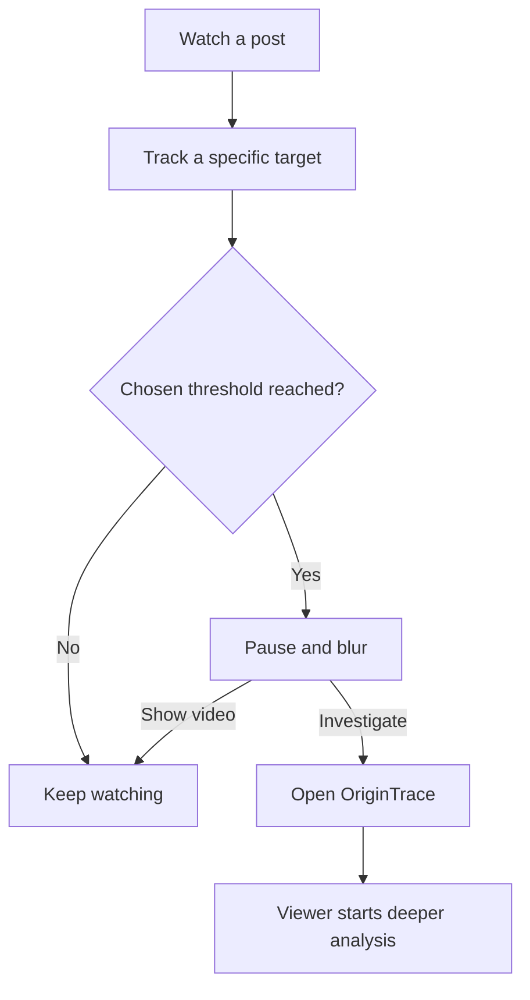
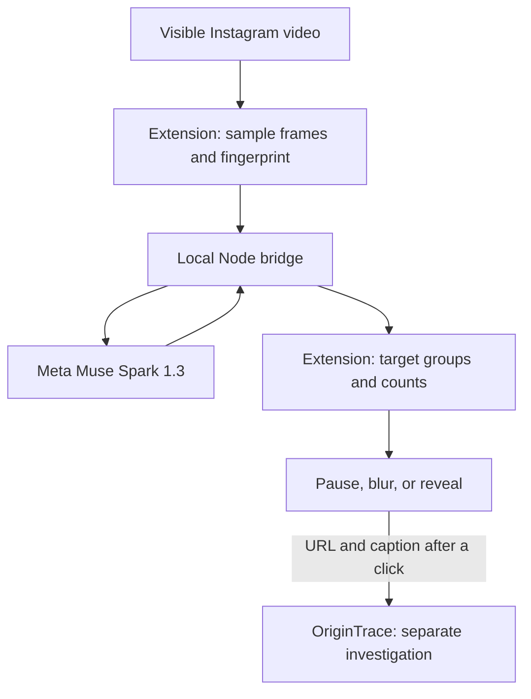

# ContextLens

### Fewer repeats. More context. Your choice.

**A Chrome extension that helps viewers notice repeated exposure to the same specific challenge, product, or campaign—and decide when to pause.**

Built for the Meta Global AI Developer Hackathon with **Meta Muse Spark 1.3**. ContextLens connects a viewer-controlled repetition filter to **OriginTrace**, a separate investigation application.

**Prototype 1.0.1** · Chrome Manifest V3 · Node.js 22.13+

[Why we built it](#why-we-built-it) · [Demo flow](#demo-flow) · [How it works](#how-it-works) · [Run locally](#run-locally) · [Validation](#validation)

## Why we built it

A new post is not always a new idea.

Different creators can repeat the same dance challenge, promote the same product, or circulate the same political campaign. A viewer may encounter that pattern without seeing how often it has appeared. At the same time, posts about the same broad subject can concern entirely different things.

We built ContextLens to make that repetition visible and give the viewer a practical choice: **continue watching, take a pause, or investigate further**. The intended benefit is greater awareness and control over attention; it has not yet been measured in a user study.

The viewer chooses the threshold. ContextLens applies it to a specific tracked target, rather than treating every cake, dance, or political video as one group.

## What the viewer can do

| Capability | Behavior |
| --- | --- |
| Recognize a repeated target | Compare visible footage and semantic observations across posts, even when presenters or filming conditions change. |
| Choose a repetition limit | Set **N from 2 to 25**. |
| Choose the counting unit | **Unique posts** includes different posts from one account. **Unique accounts** counts each posting account once per target. |
| Pause and blur | When a tracked target reaches N, matching content pauses and blurs. |
| Keep watching | **Show video** removes the blur and resumes playback after the viewer clicks. |
| Investigate | Open OriginTrace with the current post URL and caption prefilled; the viewer starts its separate analysis. |

Counts describe content observed in this browser. They are **not platform-wide popularity, reach, or upload totals**. Reopening one canonical post does not increase its unique-post count.



## Demo flow

The controlled demo uses fictional test content to illustrate these intended distinctions. These are **test cases, not measured recognition results**.

| Case | Intended grouping |
| --- | --- |
| Different performers repeat the same evidenced choreography | One specific challenge, when distinctive movement cues support the match. |
| Different recordings repeat the same fictional Purple campaign | One campaign, when the campaign details align. |
| A fictional Yellow campaign appears between Purple posts | A separate target; Purple's existing count persists. |
| Different posts promote the same named green matcha cake | One specific product, when product details align. |
| A strawberry cake or chocolate cake appears | Separate products, even though the display category is also **Cake**. |

To demonstrate the interaction, select **Unique posts**, set **N = 2**, and watch two different posts that the system verifies as the same target. Show the count, blur, **Show video**, and **Investigate** handoff. Any shortened analysis waits in the demo video should be identified as shortened.

**Subject, content type, format, and target have different jobs.** For example, a post can have the subject *Food*, content type *Cake*, format *Advertisement*, and a specific named cake as its target. The first three labels do not authorize a merge.

## How it works

ContextLens combines approximate visual matching with an **observe → retrieve → verify** pipeline.

1. **Observe.** With AI recognition and frame sharing enabled, the extension captures up to eight timestamped JPEG frames while a clip is visible. Muse Spark describes the target, actions, visible text, entities, distinctive cues, and uncertainty **without seeing candidate groups**.
2. **Retrieve.** Local application code searches up to 500 stored group descriptors using multilingual terms, aliases, OCR text, and action descriptions. It shortlists up to eight candidates. This is weighted text retrieval, not a vector embedding model.
3. **Verify.** A separate Spark request compares the observation with shortlisted targets. It receives the current chronological frames and, when available, up to four evenly spaced reference frames for each of the top three candidates. This preserves intermediate motion rather than comparing endpoints alone.
4. **Count and act.** Application code accepts a supported target match, deduplicates posts or accounts, saves the count, and applies the viewer's threshold. A new specific target gets its own group. Uncertain semantic results remain visible and are not counted.

A merge requires a valid candidate ID, at least two distinct shared cues, no reported conflicts, an accepted match basis, and a heuristic model confidence of at least **0.84**. That threshold is **not a calibrated probability**. A shared name, topic, category, or soundtrack cannot independently authorize a merge.

Before semantic analysis, local ordered perceptual hashes and coarse color layout can recognize similar previously observed footage. This is an approximate shortcut; it is not Meta vPDQ or proof of identity.



### Why Meta matters

The central recognition task is semantic: different recordings may depict the same precise phenomenon, while superficially similar recordings may depict different targets. Spark supplies visual and language interpretation for that comparison, including structured descriptions and uncertainty.

Meta is used in the recognition decision itself. Deterministic code handles retrieval, evidence checks, deduplication, counters, playback, and request limits. Separating observation from comparison reduces reliance on one prompt that both describes a clip and chooses its group; it does not eliminate model errors.

## Deeper investigation with OriginTrace

**ContextLens** controls repeated exposure during viewing. **OriginTrace**, contributed by Tzulun Huang / Leahsoda, investigates a selected clip through accessible media clues, captions or transcripts, related web sources, and available publication metadata.

The handoff opens a new tab and prefills the URL and caption. It **does not automatically start research or download media**. After the viewer selects **Analyze**, OriginTrace runs its own configured workflow.

Reports expose sources, context, available timelines, and uncertainty. A related article is not automatically a confirmed appearance of the same footage. Publication order does not prove copying, the first upload, the recording date, or the original creator. **Insufficient evidence** is a valid outcome.

OriginTrace has Spark-based frame and text analysis, an optional Meta hosted-search adapter, and configurable speech processing. Enabled features depend on its own environment settings and accessible inputs. The extension itself sends sampled images and metadata, not extracted audio or a downloaded Instagram video.

See [OriginTrace setup](origintrace-web/README.md) and [handoff details](OriginTrace-integration/README.md).

## Run locally

### Requirements

- Chrome with Developer mode available.
- Node.js **22.13 or newer**.
- A Meta Model API key with access to Muse Spark 1.3 for semantic recognition.
- For OriginTrace: npm dependencies and FFmpeg for uploaded-video processing. Some URL extraction paths also require yt-dlp.

The extension and ContextLens bridge have no npm dependencies. **OriginTrace has a separate install and configuration.**

### 1. Start the ContextLens bridge

From the repository root, for a **new installation only**:

```bash
cp bridge/.env.example bridge/.env
```

Set `META_API_KEY` in `bridge/.env`, then run:

```bash
npm run bridge
```

Preserve an existing `.env` instead of overwriting it. Keep the printed pairing token for the next step. The bridge listens at **http://127.0.0.1:8766**.

### 2. Load the Chrome extension

1. Open `chrome://extensions` and enable **Developer mode**.
2. Select **Load unpacked** and choose this repository's **extension/** directory.
3. In the ContextLens popup, paste the **pairing token**, not the Meta API key.
4. Enable **AI recognition** and **Share sampled frames** to use semantic recognition.
5. Select **Unique posts** or **Unique accounts**, choose N, and save.
6. Refresh the Instagram tab and play a clip until analysis completes.

With AI disabled or frames withheld, recognition is limited to approximate matching footage. If the post permalink is unavailable, unique-post mode does not invent an ID: open the Reel directly and refresh. Diagnostics distinguish observation uncertainty, comparison decisions, and missing post URLs.

### 3. Start OriginTrace in another terminal

```bash
cd origintrace-web
npm ci
# New installation only; preserve an existing .env:
cp .env.example .env
```

Configure **origintrace-web/.env** separately, following its [README](origintrace-web/README.md). Then:

```bash
npm run dev
```

Open **http://127.0.0.1:5173/** and use that address in the extension's **OriginTrace website** setting. The development backend uses port **3001**. Keep both the bridge and OriginTrace running.

**Search configuration matters:** OriginTrace's default strict billing mode blocks Meta hosted search. Its README explains explicit best-effort opt-in and the estimated billing tradeoff, as well as the alternative provider configuration. Do not treat a loaded report page as proof that retrieval succeeded.

When updating, preserve existing environment files and accounting records.

## Data handling and usage controls

- **Opt-in frame sharing:** semantic recognition requires both AI recognition and sampled-frame sharing to be enabled.
- **Backend credentials:** the Meta key stays in the bridge environment; the extension stores a local pairing token.
- **Local history:** Chrome stores target descriptors, fingerprints, post/account evidence, and counts—not sampled JPEGs.
- **Temporary frame cache:** the bridge retains up to 32 observations, including up to eight frames each, in memory for up to one hour. A restart clears that cache.
- **Request accounting:** `DAILY_META_LIMIT=200` limits actual bridge inference attempts, including verification and retries. It persists across restarts and resets at UTC midnight. It is a local request limit, not a provider billing cap.
- **Separate investigation boundary:** OriginTrace has its own credentials, media processing, source requests, and budget ledger. Review its configuration before enabling those features.

Do not commit real `.env` files, pairing tokens, usage ledgers, private uploads, or private evaluation results. The repository includes example environment files and ignore rules.

## Validation

| Check | Recorded result | What it establishes |
| --- | --- | --- |
| ContextLens regression suite | **56 passed** | Counting units, replay deduplication, permalink boundaries, retrieval, match guards, temporal-frame delivery, diagnostics, and budget behavior. |
| JavaScript syntax and manifest checks | **Passed; 25 files** | Syntax validity and declared content-script presence. |
| Earlier real-provider smoke checks | Recorded in [validation](docs/VALIDATION.md) | Request/response behavior on synthetic fixtures; not real-world recognition accuracy. |
| Live recognition on the generated demo videos | **Not measured for this revision** | Requires direct evaluation; passing mocked tests does not establish model accuracy. |
| Full OriginTrace suite and live browser automation | **Not established by the ContextLens checks** | Must be evaluated separately. |

Run the dependency-free ContextLens checks from the repository root:

```bash
npm run check
npm test
```

For local clips, run `npm run feed` and open **http://127.0.0.1:8765/real.html**. Use media you are authorized to test. The page is a manual inspection aid, not an accuracy benchmark.

An optional labeled-video evaluator lives in [tools/evaluate.cjs](tools/evaluate.cjs), with a [manifest example](benchmarks/manifest.example.json). Paid model requests require its explicit `--run` flag. Evaluation should report false matches, missed repetitions, unclassified clips, latency, and request counts—not only successful examples.

## Current limits and next steps

Recognition is experimental. Sparse frames, compression, occlusion, unfamiliar movement, and inconsistent descriptions can produce missed or incorrect matches. Instagram layout changes and inaccessible media can also prevent analysis. The extension does not run ASR, recognize soundtracks from audio, verify political claims, or determine whether a product advertisement is truthful.

The next priorities are a labeled positive/negative clip set, measured recognition and latency comparisons, stronger motion correspondence, and clearer user review of ambiguous groups. OriginTrace additionally needs broader evidence coverage and production hardening. No measured accuracy improvement or user-impact result is claimed here.

## Repository map

| Path | Purpose |
| --- | --- |
| [extension/](extension/) | Chrome UI, frame capture, local history, counting, and playback control. |
| [bridge/](bridge/) | Authenticated local Meta requests, observation, verification, frame cache, and attempt ledger. |
| [origintrace-web/](origintrace-web/) | Separate OriginTrace frontend and backend. |
| [OriginTrace-integration/](OriginTrace-integration/) | URL/caption handoff documentation. |
| [tests/](tests/) | ContextLens local regression tests. |
| [tools/](tools/) | Checks, provider smoke, browser fixture, and labeled-video evaluation. |
| [docs/VALIDATION.md](docs/VALIDATION.md) | Test scope, recorded results, and evaluation limits. |

## Team and attribution

- **Jonghoon Ahn** — ContextLens extension and companion bridge.
- **Tzulun Huang / Leahsoda** — OriginTrace investigation application.

ContextLens and OriginTrace retain their distinct names and attribution. This is an independently developed hackathon prototype using Meta models.

**License status:** no repository-wide `LICENSE` file is currently included. A project-wide license needs agreement from the relevant contributors before an open-source release; no blanket license is asserted by this README.
