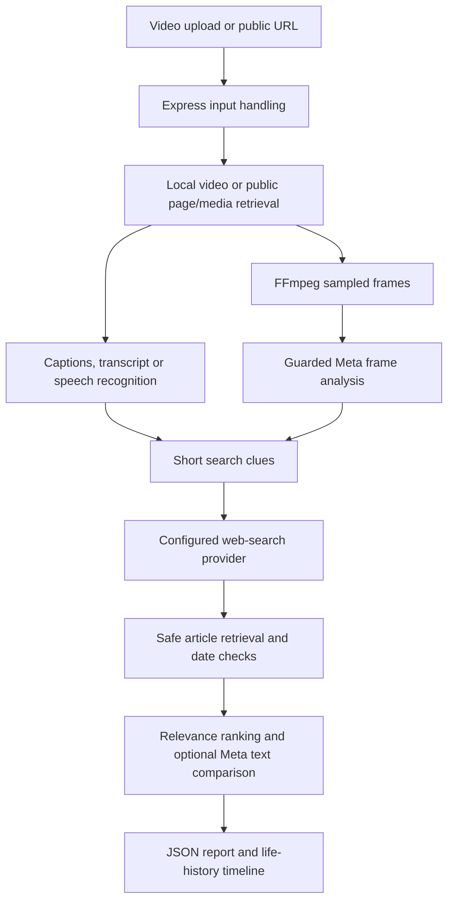

# Architecture

OriginTrace connects video clues, source evidence and temporal context to help users investigate the changing stories behind viral footage. The full project combines context discovery, claim comparison and footage-lineage presentation. This guide distinguishes the documented implementation from the architecture needed for the broader product.

OriginTrace uses npm workspaces for a Vite frontend and an Express backend. The frontend calls `/api` through Vite's development proxy. The backend orchestrates media extraction, provider calls, evidence retrieval and report generation.

## Implemented processing pipeline

Product intent and implementation gaps are mapped in [scope](SCOPE.md). This diagram describes the documented application pipeline. Its life-history output organizes related coverage; it does not establish verified visual provenance.

The hackathon's primary journey is upload-first. Public URL handling is an additional input path whose media and metadata availability depend on platform access. The current UI presents source cards, quoted comparisons, a life-history timeline and JSON export; a contextual overlay and side-by-side media player remain planned.

## Source responsibilities

| File or directory | Responsibility |
| --- | --- |
| `frontend/src/main.js` | Input handling, API calls, report rendering and in-memory report history |
| `frontend/src/footageHistory.js` | Life-history timeline and provenance disclosures |
| `backend/server.js` | Environment loading, middleware, health endpoint and routing |
| `backend/routes/analysis.js` | Multipart upload limits, input validation and upload cleanup |
| `backend/services/videoAnalyzer.js` | Analysis orchestration, frame sampling and response contract |
| `backend/services/urlContext.js` | Public URL retrieval, HTML metadata/text and embedded Instagram parsing |
| `backend/services/platformMedia.js` | Optional Instagram-only yt-dlp metadata fallback |
| `backend/services/clipText.js`, `metaSpeech.js` | Bounded audio conversion and local/guarded Meta transcription |
| `backend/services/searchClues.js` | Local extraction of short searchable clues |
| `backend/services/sourceDiscovery.js` | Search planning, candidate selection, article retrieval and comparisons |
| `backend/services/metaSearch.js` | Optional best-effort Meta hosted-search adapter |
| `backend/services/evidenceRanking.js` | Date consistency, textual matching and weighted source ranking |
| `backend/services/metaComparison.js` | Guarded excerpt comparison and quote-backed historical claims |
| `backend/services/footageHistory.js` | Exact-file hashing, dated coverage timeline and uncertainty labels |
| `backend/services/metaBudget.js` | Persistent atomic accounting, rate/concurrency limits and disable controls |
| `backend/doctor.js`, `budgetReview.js` | Local diagnostics and operator review |

Paths are relative to `video-context-engine/`.

## Trust and evidence boundaries

User input, filenames, frame text, page content and source excerpts are untrusted. The backend owns provider credentials and makes paid calls through the spending guard. Retrieved source text and quoted claims remain evidence to assess, not instructions to execute.

Ranking is `100 × (0.5 × domain weight + 0.3 × chronology + 0.2 × relevance)`. It is not a truth probability. Page publication dates, post publication dates and event dates are distinct. Chronological ordering does not establish copying or a verified chain of footage versions.

The life-history section reconstructs located related coverage. It does not perform perceptual reverse-video matching, verify the original creator or validate signed C2PA manifests. SHA-256 identifies exact uploaded bytes only.

## Full-project architecture direction

The following responsibilities describe planned development, not additional services already implemented.

| Layer | Intended responsibility | Current foundation and remaining work |
| --- | --- | --- |
| Context discovery | Turn frame/text clues into inspectable candidate sources and appearances | Frame analysis, search and selected article retrieval exist. Broader platform coverage and explicit candidate-appearance verification remain planned. |
| Media correspondence | Establish whether source media contains the uploaded footage and identify aligned intervals or visible edits | Exact-byte hashing exists. Perceptual matching, crop/excerpt handling, temporal alignment and edit comparison remain planned. |
| Claim comparison | Compare date, location, event and identity claims with quoted evidence | Excerpt comparison and supported claim pairs exist. Structured claim extraction and evaluated contradiction classification remain planned. |
| Evidence relationships | Preserve sources, observations, claims, review decisions and relationship types over time | Per-report JSON exists. Persistent evidence storage, stable cross-report identities and review history remain planned. The budget database is not this store. |
| Contextual presentation | Show concise findings with expandable evidence and a visual appearance timeline | Current report rendering provides a foundation. Side-by-side media, matched timecodes and an optional at-viewing overlay remain planned. |

### Evidence relationship design

The full product should keep the following concepts separate:

- **Observation:** a visible or transcribed detail from the submitted clip, with its extraction method.
- **Source record:** a retrieved URL, excerpt, retrieval time and available publication metadata.
- **Appearance candidate:** a source that may contain the footage; related reporting alone does not qualify as a confirmed appearance.
- **Media correspondence:** evidence of matching media, including compared intervals and the method used.
- **Claim and finding:** what a post or article asserts, and the system's assessment with supporting references and unresolved questions.
- **Timeline relationship:** chronological order, confirmed media correspondence or documented derivation, each explicitly typed.

These are design requirements for future schema evolution, not a statement that those fields or relationship types exist in the current API. Preserve the current response contract until coordinated backend and frontend changes implement them.

### Narrative timeline behavior

The planned visual lineage interface compares what each located appearance shows and claims. It should expose changes in captions, dates, locations, descriptions and visible edits when supported by accessible evidence.

A chronological edge must never silently become a copying or derivation edge. Source-reported modifications must remain distinguishable from edits detected through direct media comparison. Unknown recording dates and gaps in platform coverage must remain visible.

## Verification and evaluation boundaries

Control tests and pipeline tests establish software behavior, not contextual truth. Evaluate retrieval and evidence support using manually checked clip records; evaluate media matching separately once implemented. Measure user understanding through user studies rather than inferring social impact from a successful API response.

The hackathon acceptance criteria, evaluation cases and staged roadmap are defined in [scope](SCOPE.md).

See [operations](OPERATIONS.md) for provider configuration, budget assumptions, request failure handling, persistence and deployment requirements.
