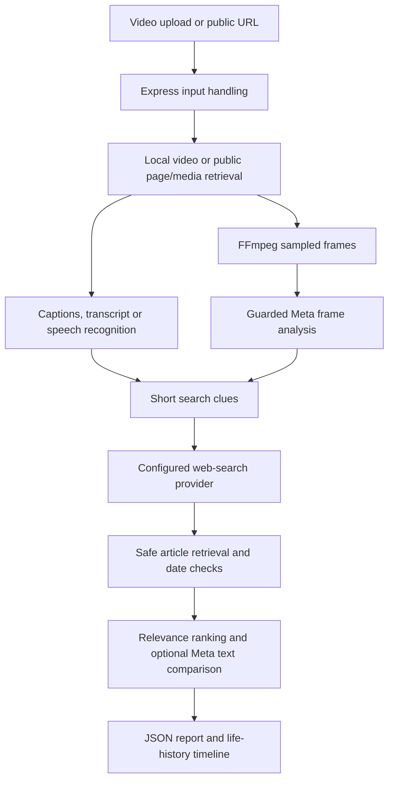

# Architecture

OriginTrace uses npm workspaces for a Vite frontend and an Express backend. The frontend calls `/api` through Vite's development proxy. The backend orchestrates media extraction, provider calls, evidence retrieval and report generation.

Product intent and unimplemented capabilities are mapped in [scope](SCOPE.md). This diagram describes the current research pipeline, not a verified visual-provenance system.

## Source responsibilities

| File or directory | Responsibility |
| --- | --- |
| `frontend/src/main.js` | Input handling, API calls, report rendering and in-memory report history |
| `frontend/src/footageHistory.js` | Life-history timeline and provenance disclosures |
| `backend/server.js` | Environment loading, middleware, health endpoint and routing |
| `backend/routes/analysis.js` | Multipart upload limits, input validation and upload cleanup |
| `backend/services/videoAnalyzer.js` | Analysis orchestration, frame sampling and response contract |
| `backend/services/urlContext.js` | Public URL retrieval, HTML metadata/text and embedded Instagram parsing |
| `backend/services/platformMedia.js` | Optional Instagram-only yt-dlp metadata fallback |
| `backend/services/clipText.js`, `metaSpeech.js` | Bounded audio conversion and local/guarded Meta transcription |
| `backend/services/searchClues.js` | Local extraction of short searchable clues |
| `backend/services/sourceDiscovery.js` | Search planning, candidate selection, article retrieval and comparisons |
| `backend/services/metaSearch.js` | Optional best-effort Meta hosted-search adapter |
| `backend/services/evidenceRanking.js` | Date consistency, textual matching and weighted source ranking |
| `backend/services/metaComparison.js` | Guarded excerpt comparison and quote-backed historical claims |
| `backend/services/footageHistory.js` | Exact-file hashing, dated coverage timeline and uncertainty labels |
| `backend/services/metaBudget.js` | Persistent atomic accounting, rate/concurrency limits and disable controls |
| `backend/doctor.js`, `budgetReview.js` | Local diagnostics and operator review |

Paths are relative to `video-context-engine/`.

## Trust and evidence boundaries

User input, filenames, frame text, page content and source excerpts are untrusted. The backend owns provider credentials and makes paid calls through the spending guard. Retrieved source text and quoted claims remain evidence to assess, not instructions to execute.

Ranking is `100 × (0.5 × domain weight + 0.3 × chronology + 0.2 × relevance)`. It is not a truth probability. Page publication dates, post publication dates and event dates are distinct. Chronological ordering does not establish copying or a verified chain of footage versions.

The life-history section reconstructs located related coverage. It does not perform perceptual reverse-video matching, verify the original creator or validate signed C2PA manifests. SHA-256 identifies exact uploaded bytes only.

See [operations](OPERATIONS.md) for provider configuration, budget assumptions, request failure handling, persistence and deployment requirements.
